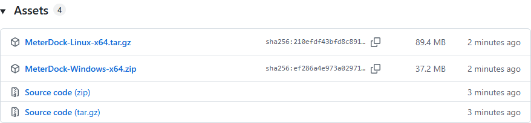
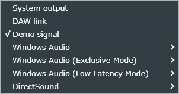
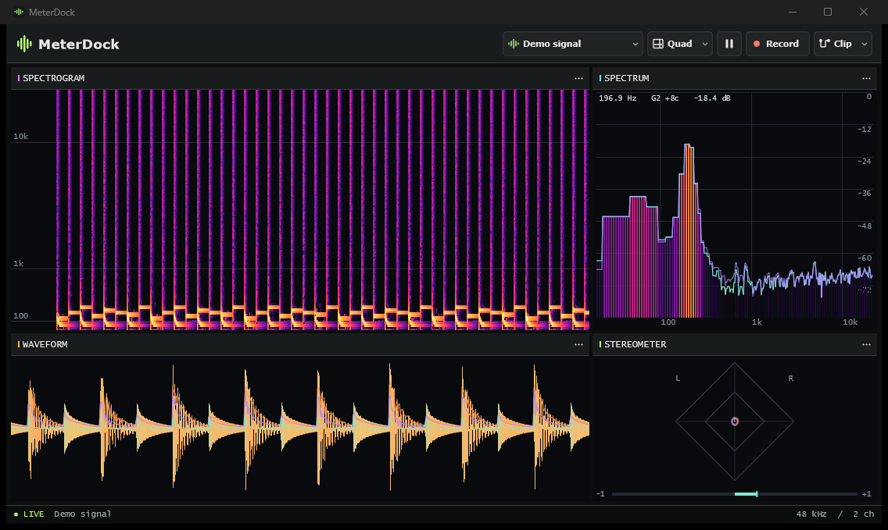
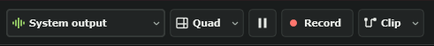
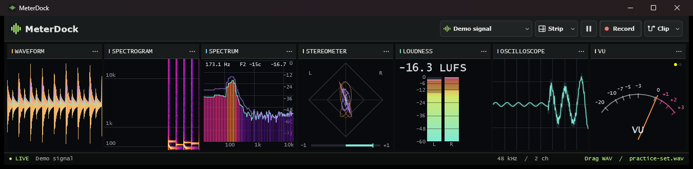
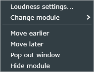
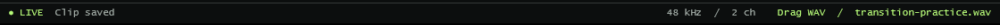
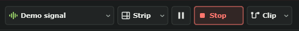
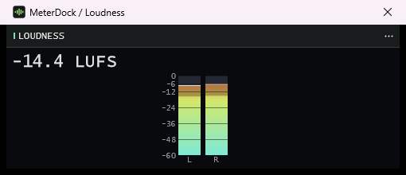

# MeterDock

MeterDock shows what is happening in stereo audio as you play it. Watch a microphone level while you record, compare two takes, or replay the few seconds where a DJ transition got unexpectedly loud. You can run it alongside your player or open a meter directly on a track in your digital audio workstation (DAW).

**[Download for Windows x64](https://github.com/1aifanatic/MeterDock/releases/latest/download/MeterDock-Windows-x64.zip)** · **[Download for Linux x64](https://github.com/1aifanatic/MeterDock/releases/latest/download/MeterDock-Linux-x64.tar.gz)**

## Your first session

The screenshots show MeterDock 1.0.0 on Windows. Linux has the same meter controls. The device names and file dialogs depend on your system.

### 1. Download, extract, and launch

| Platform | What to do |
| --- | --- |
| Windows x64 | Download **MeterDock-Windows-x64.zip**. Right-click it, choose **Extract All**, then open the extracted folder and double-click **MeterDock.exe**. |
| Linux x64 | Download **MeterDock-Linux-x64.tar.gz**. Extract it, open a terminal in the extracted **MeterDock-linux-x86_64** folder, and run `./MeterDock`. Keep `libMeterDockWayland.so` beside the executable. The Linux package was tested on Ubuntu 24.04. |

If you use the release page, choose the asset with your operating system in its name. Both packages contain the standalone app, seven individual meter plug-ins, a Quad plug-in, and a Sender plug-in. You can start the standalone app immediately. [Release page](https://github.com/1aifanatic/MeterDock/releases/latest)

### 2. Try a signal before connecting any equipment

Open the **input menu** in the top toolbar. The button displays the current source name. Choose **Demo signal**. The demo is silent and drives the graphs internally, so you can test the display with your speakers muted.

In **Quad**, watch the bottom-left *Waveform*. Each pulse leaves a shape that moves across the display. The top-right *Spectrum* shows where that pulse's energy falls across frequencies. If you see both change, the app is running.

### 3. Watch audio from your player or microphone

For a player or browser, choose **System output**, then play a track through your computer's default output. Pause it for a few seconds and start it again. The waveform should become quiet and then fill in as playback resumes.

For a microphone or audio interface, open the input menu, expand the relevant audio-device group, and choose the input carrying the signal. Speak a sentence or play a few notes while watching the waveform.

### 4. Choose meters for the job

Open the layout button beside the input menu and select **Horizontal strip**. This places the meters side by side. Select **Quad** to return to the larger four-panel workspace.

| What you want to check | Meter | What to look for |
| --- | --- | --- |
| When a sound starts, stops, or spikes | Waveform | Peaks and gaps over time |
| Whether bass, midrange, or treble dominates right now | Spectrum | The relative height of different frequency ranges |
| Whether a frequency persists after a sound ends | Spectrogram | A band that continues through time |
| Whether two passages feel similarly loud | Loudness | Compare the same LUFS mode over similar passages. A reading of −14 LUFS is louder than −20 LUFS. |
| How the left and right channels relate | Stereometer | Changes in the stereo trace and correlation as the passage plays |
| What a repeating signal looks like over a few cycles | Oscilloscope | The shape and symmetry of individual cycles |
| How steadily a performance holds its level | VU | The movement of the calibrated needle |

To keep one meter beside your editor, open its **…** menu and choose **Pop out window**. Close the floating window to return it to the workspace. The screenshot shows the Loudness module's menu.

### 5. Save the ten seconds you just heard

Let the current source play for at least ten seconds. Immediately after the moment you want to keep, click **Clip → Last 10 seconds**, choose a filename such as `transition-practice.wav`, and save. **Last 60 seconds** works the same way. If you just switched inputs, the clip contains the available history from the new input.

Double-click the saved WAV in your file manager to hear it, or drag its name from MeterDock's footer into an audio editor. This is the footer after saving the example clip.

### 6. Record a whole take

For a podcast take, rehearsal, or longer mix, click **Record**, choose a WAV destination, and save. Start the performance once the toolbar shows the red **Stop** button. Click **Stop** when you're finished, then open the WAV from the folder you chose. Right-click **Record** to find recent recordings again.

## Before and after examples

These are example workflows. Make level and EQ adjustments in your recording app or mixer, then use MeterDock to check the result.

| Situation | Before | What to do | After |
| --- | --- | --- | --- |
| Match two spoken introductions | The replacement intro sounds quieter than the original, even though both have an occasional tall peak. | Play a similar sentence from each take at the same playback volume. In **Loudness settings**, choose **Metering ? Short-term LUFS (3 s)**. Adjust the quieter clip's gain in your editor and replay the same sentences. | For example, readings of −21 and −16 LUFS may end up near −17 and −16 LUFS. Listen through the edit to decide whether the handoff sounds natural. |
| Find an intermittent hum | You hear a low tone during a call rehearsal, but miss it when you stop to investigate. | Monitor the microphone and watch **Spectrogram** during a quiet pause. When a steady band appears, save the last ten seconds. Change one suspected source, such as a nearby fan, and repeat the pause. | You have two clips to compare and can see whether the band disappeared after that change. |
| Catch a problem in a long rehearsal | A note crackles halfway through a practice session. By the time you reach for Record, the moment is over. | Keep MeterDock on the rehearsal input. Click **Clip → Last 10 seconds** just after the crackle, then replay the WAV. | You have a short, repeatable example to inspect in your editor or share with the person mixing the session. |

### DJ example — rehearse a bass handoff

**Before the transition.** Track A sounds balanced on its own. When Track B's kick enters, the blend gets noticeably louder for two bars. You want to hear whether overlapping bass is responsible.

1. Route the **master mix** to MeterDock. Use **System output** if the DJ software plays through the computer's default device. For an external mixer, select an interface input receiving its record output. Play each deck separately and confirm both appear in MeterDock.
2. Choose **Horizontal strip**. Open **Loudness → … → Loudness settings** and choose **Metering ? Short-term LUFS (3 s)**. Watch **Spectrum** and **Loudness** as you play Track A alone, then repeat the transition. Look for a low-frequency rise coinciding with the loudness jump.
3. Immediately save the last ten seconds as `blend-before.wav`. Rehearse the same bars again. This time, ease down the outgoing deck's low EQ as the incoming bass takes over. Keep the master setting and transition timing the same.
4. Save `blend-after.wav` and listen to both clips at the same playback volume. Compare the low-frequency buildup and the loudness change through the handoff.

**After the adjustment.** A successful second pass keeps the impact of the incoming kick while the blend stays closer to the surrounding bars in level. The best setting depends on the two records. The meter below shows how the readout looks during playback.

## Use MeterDock inside a DAW

1. Copy the desired plug-ins from the package's **VST3** or **CLAP** folder to a directory your DAW scans. Keep each `.vst3` bundle intact. Common directories are `C:\Program Files\Common Files\VST3` and `C:\Program Files\Common Files\CLAP` on Windows, and `~/.vst3` and `~/.clap` on Linux.
2. Rescan plug-ins in the DAW. Insert **MeterDock Quad** on the master bus to see four meters, or insert one meter on an individual track. Press play and open the plug-in editor.
3. To use the standalone window for that track instead, insert **MeterDock Sender** on the track or bus and choose **DAW link** in the standalone input menu. Play audio through that channel. Use one active sender at a time on the same computer.

## If the meters stay still

- **Try Demo signal.** If the display moves, check which source is selected and whether audio reaches it. If the pause button is active, press **Space** to resume the standalone display.
- **Check the output device.** A browser, DAW, or DJ app can send audio to a different device from the system default. Use the matching input, an interface loopback if available, or the Sender plug-in in a compatible host.
- **On Linux**, system output capture uses `parec` and a PulseAudio or PipeWire-Pulse server. On Ubuntu, `parec` is provided by `pulseaudio-utils`.
- **On Windows**, if startup reports a missing `MSVCP140.dll` or `VCRUNTIME140.dll`, install the x64 Visual C++ runtime. [Microsoft download](https://learn.microsoft.com/en-us/cpp/windows/latest-supported-vc-redist)
